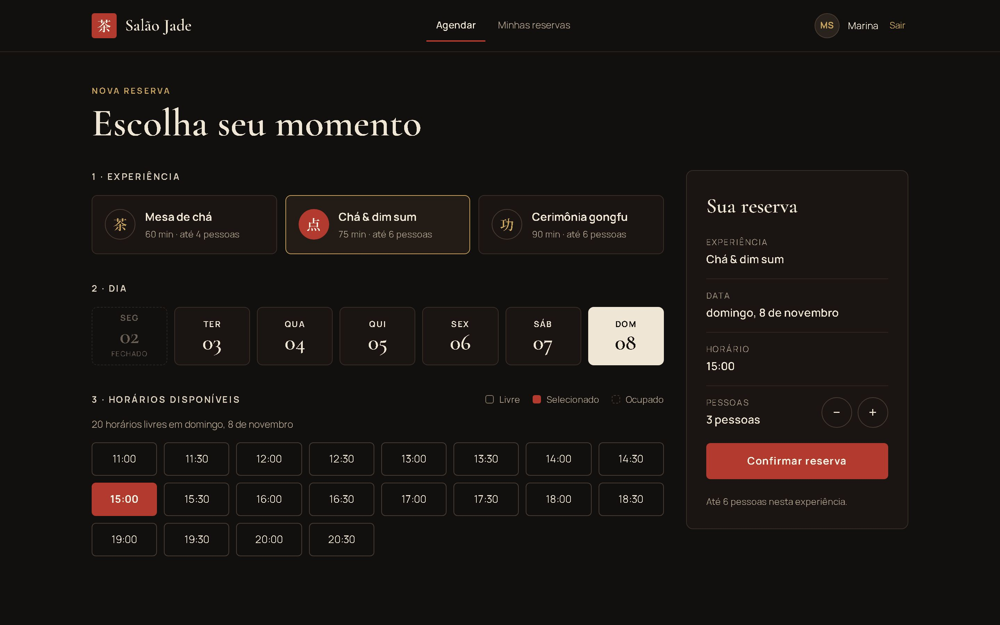
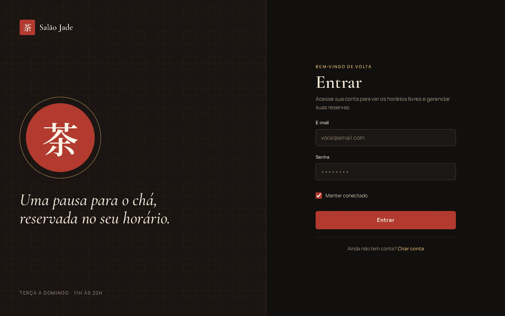
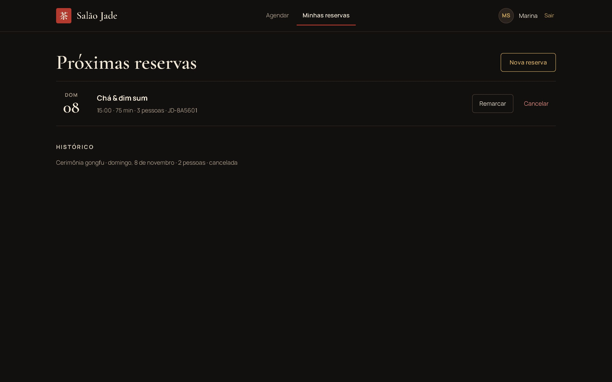
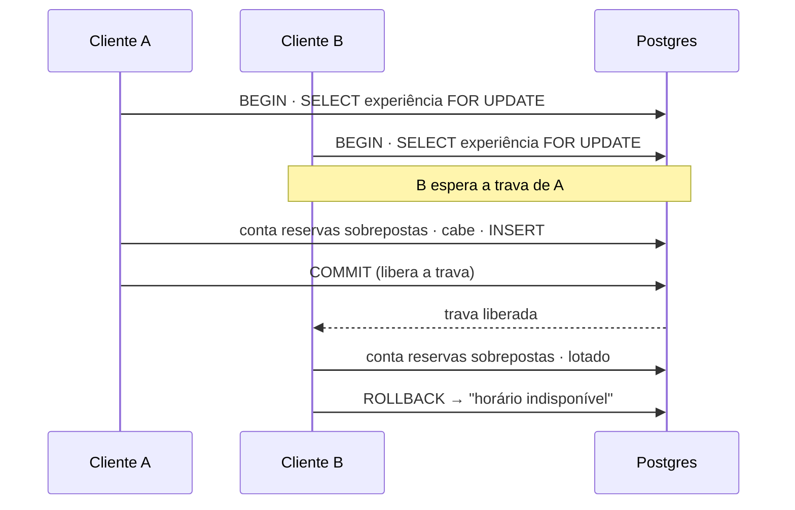
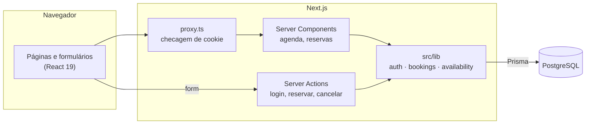
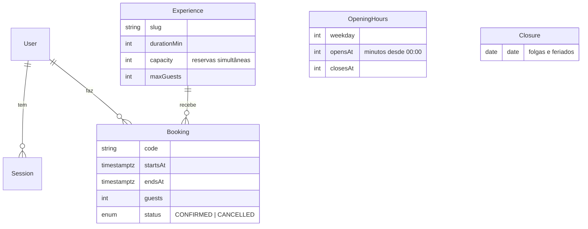

# Salão Jade

Sistema de reservas para uma casa de chá: o cliente cria a conta, vê os horários livres de verdade e reserva,
remarca ou cancela, sem chance de duas pessoas ficarem com a mesma vaga.

**Stack:** Next.js 16 (App Router, Server Actions, Cache Components) · TypeScript · Tailwind CSS 4 · PostgreSQL ·
Prisma 7 · Zod · argon2 · Vitest · Playwright



| Login | Minhas reservas | Celular |
|---|---|---|
|  |  |  |

## O que dá para fazer

- Criar conta e entrar, com sessão que expira e opção "manter conectado"
- Escolher a experiência (mesa de chá, cerimônia gongfu, chá & dim sum), o dia e um horário livre
- Ver na hora o que está ocupado, com dias fechados e horários passados bloqueados
- Remarcar ou cancelar até 24 horas antes

## Destaques técnicos

### Sem reserva dupla, nem com cliques simultâneos

Dois clientes podem confirmar o mesmo horário no mesmo instante. Criar e remarcar passam por
[`claimSlot`](src/lib/bookings.ts), dentro de uma transação que trava a linha da experiência com
`SELECT … FOR UPDATE`. As reservas daquela experiência são checadas e gravadas uma de cada vez, e quem chega depois
recebe "esse horário acabou de ficar indisponível" com a grade já atualizada.



[`bookings.db.test.ts`](src/lib/bookings.db.test.ts) prova isso contra o Postgres real: 10 pedidos ao mesmo tempo
geram **exatamente 1** reserva quando a capacidade é 1, e **exatamente 6** quando é 6.

### Uma regra de disponibilidade só

Os horários não ficam salvos no banco: [`buildSlots`](src/lib/availability.ts) é uma função pura que gera a grade a
cada 30 minutos dentro do expediente e marca como ocupado o horário que já passou ou cujas reservas sobrepostas
atingiram a `capacity`. A mesma função monta a tela e valida a reserva no servidor, então a tela e o banco nunca
discordam sobre o que está livre. Intervalos são meio-abertos: uma reserva que termina às 16:00 não bloqueia as 16:00.

### Autenticação feita à mão, com os cuidados de produção

- Senhas com **argon2id**; mensagens de erro genéricas
- Login verifica a senha mesmo quando o e-mail não existe, para o tempo de resposta não revelar quais contas existem
- Limite de 5 tentativas a cada 15 minutos por IP + e-mail
- Sessão no banco guardando só o **SHA-256 do token**: um vazamento da tabela não permite sequestrar sessões
- Cookie `httpOnly`, `SameSite=Lax`, `Secure` em produção
- [`proxy.ts`](src/proxy.ts) barra quem não tem cookie; [`getCurrentUser()`](src/lib/auth.ts) valida a sessão perto
  dos dados, e toda consulta de reserva filtra pelo dono

### Next.js 16 com Cache Components

O que é igual para todos (títulos, layout) sai pré-renderizado; o que depende da sessão ou da URL chega por
streaming dentro de `<Suspense>`, com esqueletos de carregamento. Experiência e dia ficam na URL
(`/agenda?exp=…&dia=…`): dá para compartilhar o link e o botão voltar funciona.

## Arquitetura





Horários são gravados em UTC (`timestamptz`) e convertidos para `America/Sao_Paulo` só na tela.

## Rodando localmente

Requisitos: Node 22+ e Docker.

```bash
npm install
cp .env.example .env
npm run db:up        # Postgres na porta 5434
npm run db:migrate   # cria as tabelas
npm run db:seed      # experiências, horário de funcionamento e conta demo
npm run dev
```

Conta demo: `demo@salaojade.dev` / `chaverde123`.

## Testes

| Comando | O que cobre |
|---|---|
| `npm test` | Vitest: grade de horários, fuso, validação, limite de tentativas e, contra o Postgres, concorrência, remarcação, cancelamento e prazo de 24h |
| `npm run test:e2e` | Playwright: visitante barrado, e o fluxo entrar → reservar → ver → cancelar num build de produção |
| `npm run lint` | ESLint |

Os testes de banco e o e2e precisam do Postgres no ar e semeado. `SCREENSHOTS=1 npm run test:e2e` regrava os prints
deste README.

## Limites conhecidos e próximos passos

- O limite de tentativas de login fica em memória: zera a cada reinício e não é compartilhado entre instâncias.
  Antes de escalar, trocar por Redis.
- O fuso usa offset fixo (-03:00), exato enquanto São Paulo não tiver horário de verão.
- Próximos passos: painel do salão para gerenciar experiências e folgas, e-mail de confirmação, recuperação de senha.
