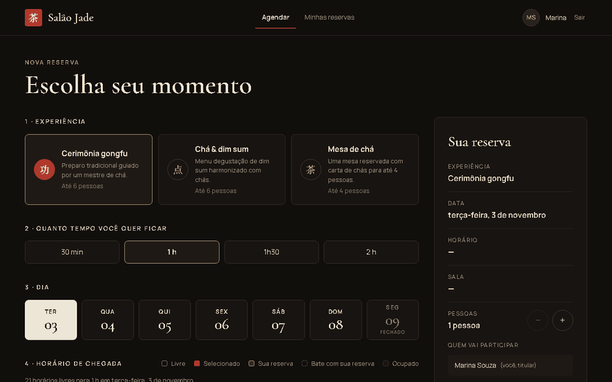
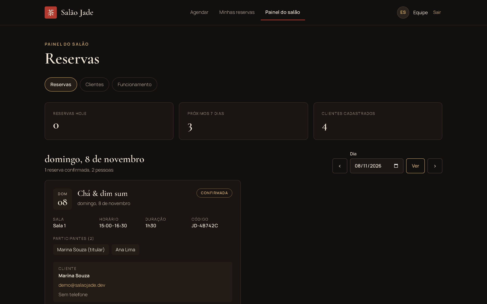
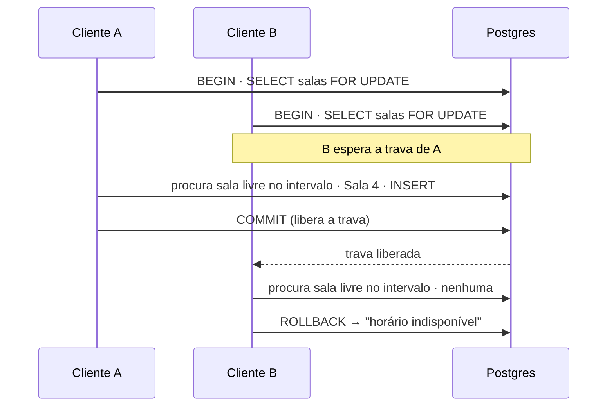
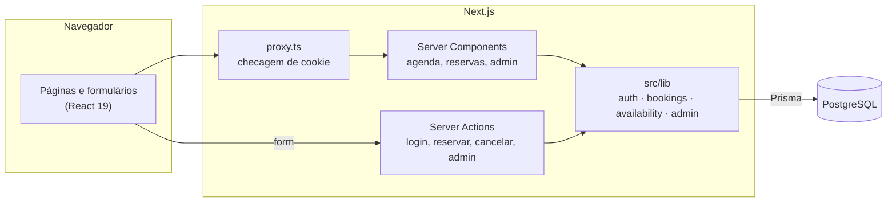
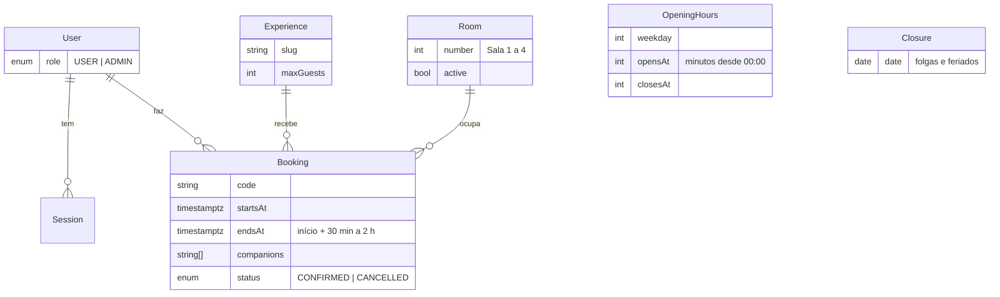

# Salão Jade

[](https://github.com/VryDeveloper/salao-jade/actions/workflows/ci.yml)
[](https://salao-jade.vercel.app)


Sistema de reservas full-stack para uma casa de chá: o cliente cria a conta, escolhe experiência, duração e horário,
recebe uma das 4 salas e informa quem vai junto. O salão gerencia tudo num painel próprio. **Duas pessoas nunca
ficam com a mesma sala, nem clicando no mesmo milissegundo.**

**▶ [salao-jade.vercel.app](https://salao-jade.vercel.app)** — entre como cliente `demo@salaojade.dev` / `chaverde123`
ou como salão `admin@salaojade.dev` / `jade-admin-2026`



## Em 30 segundos

| | |
|---|---|
| **O que é** | Um produto completo, não um CRUD: cadastro e login, agenda com disponibilidade real, reserva/remarcação/cancelamento com regras de negócio, painel administrativo, deploy em produção |
| **O problema difícil** | Reserva concorrente. Resolvido com transação e trava no Postgres, e **provado por teste**: 10 pessoas pedindo o mesmo horário ao mesmo tempo geram exatamente 4 reservas (uma por sala) |
| **Segurança** | Autenticação feita à mão (argon2id, sessão com hash, cookie seguro, limite de tentativas, proteção contra enumeração de contas), papel de admin checado no servidor |
| **Qualidade** | TypeScript estrito, 47 testes unitários e de banco, 4 testes ponta a ponta no navegador, CI a cada push, testado também contra o site publicado ([relatório](docs/relatorio-de-testes.md)) |
| **Front-end** | Next.js 16 com Server Components e streaming, View Transitions, fluido em WebGL2, responsivo e acessível, com movimento reduzido respeitado |
| **Tamanho** | ~3.900 linhas de TypeScript, sem biblioteca de UI ou de autenticação |

**Stack:** Next.js 16 (App Router, Server Actions, Cache Components) · React 19 · TypeScript · Tailwind CSS 4 ·
PostgreSQL 17 · Prisma 7 · Zod 4 · argon2 · Vitest · Playwright · GitHub Actions · Vercel + Neon

## Telas

| Agenda | Minhas reservas |
|---|---|
|  |  |

| Painel do salão | Login | Celular |
|---|---|---|
|  |  |  |

## Funcionalidades

**Cliente**

- Criar conta e entrar, com sessão que expira e opção "manter conectado"
- Escolher a experiência (mesa de chá, cerimônia gongfu, chá & dim sum), **quanto tempo ficar** (30 min, 1 h, 1h30
  ou 2 h), o dia e o horário de chegada. Cada card mostra o intervalo inteiro: "13:00–15:00"
- Receber uma das **4 salas**, escolhida automaticamente
- Ver na hora o que está ocupado, o que é seu e o que bate com uma reserva sua; dias fechados e horários passados
  ficam bloqueados
- Informar **quem vai participar**, com o nome de cada acompanhante
- Ver as reservas em cards (sala, experiência, horário, duração, participantes, código); remarcar ou cancelar até
  24 horas antes

**Salão (`/admin`)**

- Reservas do dia de todos os clientes, com contato clicável; cancelar a qualquer momento antes do início
- Lista de clientes com número de reservas e próxima visita
- Fechar dias (folgas, feriados) e ativar ou desativar salas e experiências. O sistema **recusa** fechar um dia ou
  desativar uma sala que já tem reservas, para nenhum cliente ser surpreendido
- Quem não é admin recebe 404: o painel nem aparece que existe

## Para times técnicos

### Onde olhar primeiro

| Arquivo | Por quê |
|---|---|
| [`src/lib/bookings.ts`](src/lib/bookings.ts) | `claimSlot`: a transação que trava as salas e decide a reserva. Todo caminho de escrita passa por aqui |
| [`src/lib/availability.ts`](src/lib/availability.ts) | `buildSlots`: função pura que gera a grade. A mesma regra monta a tela e valida no servidor |
| [`src/lib/bookings.db.test.ts`](src/lib/bookings.db.test.ts) | Os testes de concorrência contra o Postgres real |
| [`src/lib/auth.ts`](src/lib/auth.ts) | Sessões, hash do token, `requireAdmin` |
| [`src/app/agenda/`](src/app/agenda) | Server Component que lê a URL + painel cliente com `useActionState` |
| [`e2e/booking.spec.ts`](e2e/booking.spec.ts) | O fluxo inteiro no navegador, incluindo cliques rápidos |

### Sem reserva dupla, nem com cliques simultâneos

Um horário só é reservado se houver **uma sala livre durante todo o intervalo**, e o mesmo cliente **não pode ter
duas reservas que se sobrepõem**. Criar e remarcar passam por `claimSlot`, numa transação que trava as salas com
`SELECT … FOR UPDATE`: os pedidos são checados e gravados um de cada vez. Quem chega depois recebe "esse horário
acabou de ficar indisponível" com a grade já atualizada.



**Prova:** 10 pessoas pedindo o mesmo horário ao mesmo tempo → **exatamente 4** reservas, uma em cada sala.
A mesma pessoa pedindo 5 vezes ao mesmo tempo (5 abas) → **exatamente 1**.

### Decisões e trade-offs

| Decisão | Por quê | O que custa |
|---|---|---|
| Horários **calculados**, não salvos como linhas no banco | Uma regra só (`buildSlots`) para tela e servidor; mudar o horário de funcionamento não exige migrar dados | Calcula a grade a cada pedido (barato: ≤ 24 horários × 4 salas) |
| Disponibilidade **por sala**, não por contagem | Contar "4 reservas sobrepostas = lotado" erra quando duas delas estão na mesma sala em momentos diferentes | Um laço a mais por horário |
| Trava pessimista (`FOR UPDATE` nas salas) | Simples de provar correta; o volume de uma casa de chá não sente a serialização | Reservas do salão inteiro esperam umas às outras. Em escala, travar por dia ou usar exclusion constraint (`tstzrange`) |
| Intervalos meio-abertos `[início, fim)` | Uma reserva que termina às 16:00 não bloqueia as 16:00 | — |
| Autenticação própria em vez de NextAuth/Clerk | Mostrar os cuidados de segurança explicitamente; só e-mail e senha | Recuperação de senha e OAuth ficam por fazer |
| Sessão no banco guardando só o **SHA-256** do token | Vazar a tabela não permite sequestrar sessões; logout revoga de verdade | Uma consulta por pedido (com `cache` do React por renderização) |
| Escolhas na URL (`/agenda?exp=…&dur=…&dia=…`) | Link compartilhável, botão voltar funciona, Server Component lê direto | Cliques rápidos podiam usar uma URL velha: resolvido com `ParamLink`, com teste e2e |
| Admin responde **404**, não 403 | Não revela que o painel existe | — |
| Horários em UTC (`timestamptz`), fuso só na tela | Sem ambiguidade no banco | Offset fixo -03:00: certo enquanto São Paulo não tiver horário de verão |

### Autenticação

- Senhas com **argon2id**; mensagens de erro genéricas
- Login verifica a senha mesmo quando o e-mail não existe, para o tempo de resposta não revelar quais contas existem
- Limite de 5 tentativas a cada 15 minutos por IP + e-mail
- Cookie `httpOnly`, `SameSite=Lax`, `Secure` em produção (conferido no site publicado)
- [`proxy.ts`](src/proxy.ts) barra quem não tem cookie; `getCurrentUser()` valida a sessão perto dos dados, e toda
  consulta de reserva filtra pelo dono

### Next.js 16 e front-end

- **Cache Components / Partial Prerendering:** a casca da página sai estática; o que depende da sessão ou da URL chega
  por streaming dentro de `<Suspense>`, com esqueletos
- **Server Actions** com `useActionState`; toda entrada validada com Zod no servidor
- **View Transitions** com direção (ir/voltar), morph da seleção e troca de esqueleto por conteúdo
- **Fluido em WebGL2** (stable fluids: advecção, vorticidade, pressão) que pausa fora da tela e vira um quadro parado
  com movimento reduzido
- Auditado em 9 telas × 2 larguras: sem rolagem lateral, nada sem nome acessível, nenhum campo sem rótulo

### Arquitetura





```
src/
├── app/            rotas: (auth) entrar/cadastro · agenda · reservas · admin
├── components/     cabeçalho, cards, fluido, transições
├── lib/            regras de negócio + testes ao lado (*.test.ts, *.db.test.ts)
└── proxy.ts        barreira de cookie para /agenda, /reservas, /admin
prisma/             schema, migrações e seed
e2e/                Playwright
```

## Rodando localmente

Requisitos: Node 22+ e Docker.

```bash
npm install
cp .env.example .env
npm run db:up        # Postgres na porta 5434
npm run db:migrate   # cria as tabelas
npm run db:seed      # experiências, salas, horário de funcionamento e as duas contas
npm run dev
```

| Conta | E-mail | Senha |
|---|---|---|
| Cliente demo | `demo@salaojade.dev` | `chaverde123` |
| Salão (painel `/admin`) | `admin@salaojade.dev` | `jade-admin-2026` |

As duas são públicas para a demonstração. Num salão de verdade, troque a senha do admin ou não rode o seed.

## Testes

| Comando | O que cobre |
|---|---|
| `npm test` | Vitest, 47 testes: grade de horários, fuso, validação, limite de tentativas e, contra o Postgres, concorrência, remarcação, cancelamento, prazo de 24h e regras do painel |
| `npm run test:e2e` | Playwright: visitante barrado; entrar → reservar com acompanhante → ver → cancelar; painel só para admin; cliques rápidos. Builda e testa o build de produção, ou o site publicado com `E2E_BASE_URL=https://salao-jade.vercel.app` |
| `npm run lint` | ESLint |

O [CI](.github/workflows/ci.yml) roda tudo isso a cada push, com um Postgres de verdade como serviço.
`SCREENSHOTS=1 npm run test:e2e` regrava os prints deste README. Resultados detalhados, incluindo a auditoria visual
e de animações: [docs/relatorio-de-testes.md](docs/relatorio-de-testes.md).

## Deploy

Vercel + Neon. O script `vercel-build` roda `prisma migrate deploy`, o seed e o `next build`; as migrações usam a
conexão direta (`DATABASE_URL_UNPOOLED`) e a aplicação usa a conexão com pool.

## Limites conhecidos e próximos passos

- O limite de tentativas de login fica em memória: zera a cada reinício e não é compartilhado entre instâncias
  serverless. Próximo passo: Redis/Upstash.
- Fuso com offset fixo (-03:00), exato enquanto São Paulo não tiver horário de verão.
- Ainda não tem: e-mail de confirmação, recuperação de senha, lista de espera.
