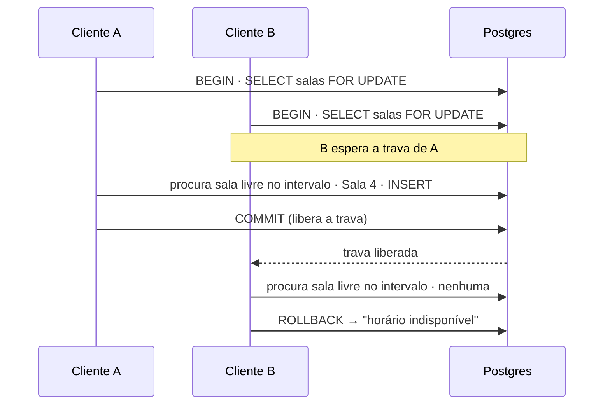
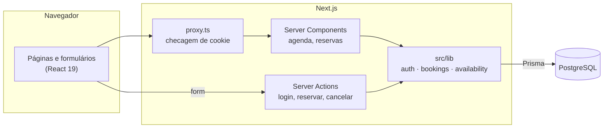
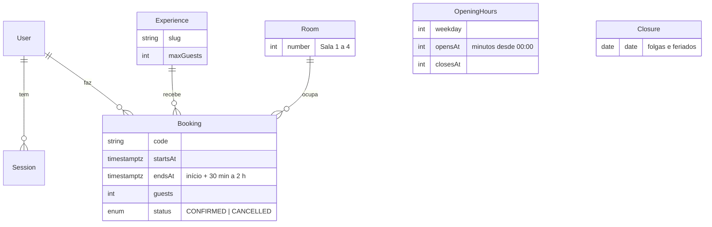

# Salão Jade

Sistema de reservas para uma casa de chá: o cliente cria a conta, vê os horários livres de verdade e reserva,
remarca ou cancela, sem chance de duas pessoas ficarem com a mesma vaga.

**Stack:** Next.js 16 (App Router, Server Actions, Cache Components) · TypeScript · Tailwind CSS 4 · PostgreSQL ·
Prisma 7 · Zod · argon2 · Vitest · Playwright


| Minhas reservas | Painel do salão |
|---|---|
|  |  |

| Login | Celular |
|---|---|
|  |  |

## O que dá para fazer

- Criar conta e entrar, com sessão que expira e opção "manter conectado"
- Escolher a experiência (mesa de chá, cerimônia gongfu, chá & dim sum), **quanto tempo ficar** (30 min, 1 h,
  1h30 ou 2 h), o dia e o horário de chegada
- Receber uma das **4 salas** do salão, escolhida automaticamente, com início, fim e sala na confirmação
- Ver na hora o que está ocupado e o que já é seu, com dias fechados e horários passados bloqueados
- Informar **quem vai participar**: o titular é quem reservou, e cada acompanhante tem o nome registrado
- Ver as reservas em cards com sala, experiência, horário, duração, participantes e código
- Remarcar (inclusive mudando a duração e os acompanhantes) ou cancelar até 24 horas antes

### Painel do salão (`/admin`)

- **Reservas do dia**, de qualquer cliente, com contato (e-mail e telefone clicáveis), participantes e sala; o
  salão pode cancelar a qualquer momento antes do início (a regra das 24h é só para o cliente)
- **Clientes** com contato, número de reservas e próxima visita
- **Funcionamento:** fechar dias (folgas, feriados), ativar e desativar salas e experiências. Fechar um dia ou
  desativar uma sala é recusado se já houver reservas afetadas, para nenhum cliente ser surpreendido
- O papel (`USER` ou `ADMIN`) é conferido no servidor em toda tela e ação; para quem não é admin, o painel
  responde 404

## Destaques técnicos

### Sem reserva dupla, nem com cliques simultâneos

O salão tem 4 salas compartilhadas por todas as experiências. Um horário só é reservado se houver **uma sala livre
durante todo o intervalo**, e o mesmo cliente **não pode ter duas reservas que se sobrepõem**, em nenhuma experiência.

Criar e remarcar passam por [`claimSlot`](src/lib/bookings.ts), dentro de uma transação que trava as salas com
`SELECT … FOR UPDATE`. As reservas são checadas e gravadas uma de cada vez, então nem pedidos simultâneos ocupam a
mesma sala, nem o mesmo cliente consegue duas reservas abrindo duas abas. Quem chega depois recebe "esse horário
acabou de ficar indisponível" com a grade já atualizada.



[`bookings.db.test.ts`](src/lib/bookings.db.test.ts) prova isso contra o Postgres real: **10 pessoas** pedindo o
mesmo horário ao mesmo tempo geram **exatamente 4** reservas, uma em cada sala; **a mesma pessoa** pedindo 5 vezes ao
mesmo tempo fica com **exatamente 1**.

### Uma regra de disponibilidade só

Os horários não ficam salvos no banco: [`buildSlots`](src/lib/availability.ts) é uma função pura que gera a grade a
cada 30 minutos para a duração escolhida e, para cada horário, procura a primeira sala sem nenhuma reserva sobreposta.
A checagem é **por sala, não por contagem**: quatro reservas sobrepostas, mas duas delas na mesma sala em momentos
diferentes, ainda deixam uma sala livre. A mesma função monta a tela e valida a reserva no servidor, então a tela e o
banco nunca discordam sobre o que está livre. Intervalos são meio-abertos: uma reserva que termina às 16:00 não
bloqueia as 16:00.

### Autenticação feita à mão, com os cuidados de produção

- Senhas com **argon2id**; mensagens de erro genéricas
- Login verifica a senha mesmo quando o e-mail não existe, para o tempo de resposta não revelar quais contas existem
- Limite de 5 tentativas a cada 15 minutos por IP + e-mail
- Sessão no banco guardando só o **SHA-256 do token**: um vazamento da tabela não permite sequestrar sessões
- Cookie `httpOnly`, `SameSite=Lax`, `Secure` em produção
- [`proxy.ts`](src/proxy.ts) barra quem não tem cookie; [`getCurrentUser()`](src/lib/auth.ts) valida a sessão perto
  dos dados, e toda consulta de reserva filtra pelo dono

### Next.js 16 com Cache Components

O que é igual para todos (títulos, layout) sai pré-renderizado; o que depende da sessão ou da URL chega por
streaming dentro de `<Suspense>`, com esqueletos de carregamento. Experiência, duração e dia ficam na URL
(`/agenda?exp=…&dur=…&dia=…`): dá para compartilhar o link e o botão voltar funciona.

## Arquitetura





Horários são gravados em UTC (`timestamptz`) e convertidos para `America/Sao_Paulo` só na tela.

## Rodando localmente

Requisitos: Node 22+ e Docker.

```bash
npm install
cp .env.example .env
npm run db:up        # Postgres na porta 5434
npm run db:migrate   # cria as tabelas
npm run db:seed      # experiências, horário de funcionamento e conta demo
npm run dev
```

Contas criadas pelo seed:

| Conta | E-mail | Senha |
|---|---|---|
| Cliente demo | `demo@salaojade.dev` | `chaverde123` |
| Salão (painel `/admin`) | `admin@salaojade.dev` | `jade-admin-2026` |

As duas são públicas para a demonstração. Em produção, troque a senha do admin ou não rode o seed.

## Testes

| Comando | O que cobre |
|---|---|
| `npm test` | Vitest: grade de horários, fuso, validação, limite de tentativas e, contra o Postgres, concorrência, remarcação, cancelamento e prazo de 24h |
| `npm run test:e2e` | Playwright: visitante barrado, e o fluxo entrar → reservar → ver → cancelar num build de produção |
| `npm run lint` | ESLint |

Os testes de banco e o e2e precisam do Postgres no ar e semeado. `SCREENSHOTS=1 npm run test:e2e` regrava os prints
deste README.

## Limites conhecidos e próximos passos

- O limite de tentativas de login fica em memória: zera a cada reinício e não é compartilhado entre instâncias.
  Antes de escalar, trocar por Redis.
- O fuso usa offset fixo (-03:00), exato enquanto São Paulo não tiver horário de verão.
- Próximos passos: painel do salão para gerenciar experiências e folgas, e-mail de confirmação, recuperação de senha.
